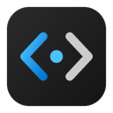

# AICode

**Un editor de escritorio modular para código, notas y trabajo asistido por IA.**

Abre un archivo y empieza a escribir. Cuando un proyecto requiera más herramientas, activa el explorador, la terminal, Git o el chat con IA. AICode funciona en macOS, Windows y Linux, y te deja elegir qué herramientas tienes a mano en cada espacio de trabajo.

[Descargar AICode](https://github.com/sorodriguezz/AICode/releases/latest) · [Read in English](README.md)

## Qué incluye

- **Un editor listo para trabajar.** Monaco, el editor que usa VS Code, ofrece pestañas, varios cursores, búsqueda y reemplazo, y compatibilidad con distintos lenguajes. La paleta de comandos y los atajos personalizables te dan acceso rápido a las acciones que más usas.
- **Herramientas para todo el proyecto.** Explora archivos, busca en toda una carpeta y ejecuta comandos en una terminal integrada con pestañas y paneles divididos. Los mods de Git incluidos te permiten preparar cambios, revisar diffs y consultar el historial de commits. Previsualiza Markdown mientras escribes y abre imágenes en el propio editor.
- **IA a tu manera.** Agrega agentes como Claude, Codex, Gemini u Ollama al chat. Activa de forma independiente el autocompletado local de código o las sugerencias de mensajes de commit. El motor integrado ejecuta modelos en tu equipo una vez descargados. También puedes conectarte a Ollama o a un servidor compatible con OpenAI.
- **Un espacio para cada forma de trabajar.** Arrastra las vistas a la izquierda, a la derecha o abajo. Usa un perfil para cada proyecto con sus propios mods, ajustes, atajos y sesión guardada. Puedes personalizar el tema, los iconos de archivos y la apariencia de la ventana.

Puedes editar sin conexión y sin crear una cuenta de AICode. La aplicación usa Tauri y la vista web de tu sistema operativo.

## Primeros pasos

1. [Descarga el instalador para tu plataforma](https://github.com/sorodriguezz/AICode/releases/latest). Elige un `.dmg` para macOS, un `-setup.exe` para Windows o un AppImage, `.deb` o `.rpm` para Linux.
2. Abre un archivo para escribir o una carpeta para trabajar en un proyecto.
3. Abre **Mods** desde el menú del engranaje. Prueba **Explorer**, **Search** y **Terminal** para armar tu espacio de trabajo. Activa **Source Control (Git)** y **Git Graph** para trabajar con tu repositorio. AICode activa sus dependencias automáticamente.

Para actualizar una instalación existente, usa **Settings → Updates → Check for Updates**.

## Hazlo tuyo

Los mods pueden agregar comandos, fragmentos de código, temas y paneles. Con un solo archivo JSON puedes crear un panel para lanzar los comandos de tu proyecto. Usa JavaScript si necesitas una vista personalizada o una integración más profunda con el editor. Exporta un mod como archivo `.aicode-mod` o comparte un perfil, con sus mods incluidos, como archivo `.aicode-profile`.

Para trabajar con agentes, el **MCP Server** opcional permite a clientes compatibles leer el contenido de los archivos abiertos, incluidos cambios sin guardar, y proponerte ediciones que puedes revisar como un diff. El mod **CodeFlow** puede ejecutar flujos con el archivo actual o una selección como entrada. Activa MCP si también quieres que los agentes de CodeFlow se conecten a AICode.

- [Crea un mod con JSON](docs/MOD-GUIDE.md)
- [Explora la API de mods en JavaScript y sus permisos](docs/MODS.md)
- [Personaliza los ajustes, temas y paneles](docs/CONFIGURATION.md)
- [Compila AICode desde el código fuente](docs/DEVELOPMENT.md)
